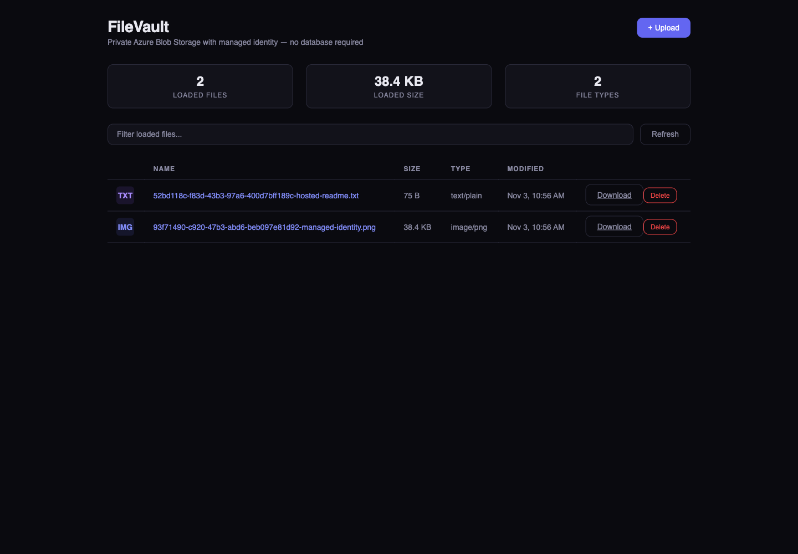

# FileVault: App Service Builder + Azure Blob Storage

A React file browser with a Node.js 24/Express backend for **private Azure Blob
Storage**. Upload, list, filter loaded files, preview raster images, download, and
delete files without a database, storage account key, connection string, SAS, or
browser-side Azure token.

This is a DEV/TEST sample for App Service Builder Private Preview, adapted from
the Embr FileVault template. Builder and Blob Storage are independent resources.
The old built-in storage proxy and its API keys are not used.



The screenshots show the actual Builder-hosted app in Microsoft Edge, using its
system-assigned managed identity against a real private Azure container:
[upload queue](docs/assets/filevault-hosted-upload.png) and
[private image preview](docs/assets/filevault-hosted-preview.png).
Required Entra sign-in and an explicit tester allowlist protected the test app.
Both synthetic files were downloaded with byte-exact comparisons, then deleted.

**Qualification:** hosted list, upload, pagination, preview, download and delete
passed in East US 2 on November 3, 2026. The separately approved temporary ZIP
test qualified hosted source and managed-identity operations, **not GitHub-source
onboarding**. Published deployment instructions below use GitHub source only.
See [the qualification record](docs/qualification.json) for the deployed source
and exact scope. This is not production-readiness or support for every preview
target; a successful `/api/health` check alone does not prove storage access.

Earlier [local browser](docs/assets/filevault-browser.png),
[upload](docs/assets/filevault-upload.png) and
[preview](docs/assets/filevault-preview.png) captures are retained separately.
Those used local developer credentials, not hosted managed identity.

## Architecture and boundaries

The browser calls same-origin `/api/files`. Express uses the official
`@azure/storage-blob` SDK. Hosted code uses `ManagedIdentityCredential`
(system-assigned by default; `AZURE_CLIENT_ID` selects a user-assigned identity).
Local development uses `DefaultAzureCredential`, including `az login`.
Only the backend reads these configuration values.

The container is private and Shared Key authentication is disabled. The sample
creates a new account with an HTTPS **public network endpoint**, authenticated
through Entra RBAC: public network reachability is not public blob access.
Builder currently has no customer VNet integration or stable outbound IP; a
private endpoint alone cannot connect it to your network. Do not weaken an
existing account's firewall to run this sample. If policy requires private-only
networking, this topology is not suitable.

Builder **Required sign-in** and explicit allowed identities protect the app.
All allowed visitors share this sample's container and can read/write/delete
every file; it is not a multi-tenant vault. The backend fails closed when
Builder's verified identity header is missing. It trusts those headers only
behind Builder, which strips client-supplied copies. Do not expose this backend
directly through another hosting provider without independent authentication.
`APP_ACCESS_MODE=local` disables visitor authentication only on a server bound
to `127.0.0.1`; never set it in Builder.

Uploads are multipart, one file per request, at most 10 MiB. The UI queues at
most 20 files and uploads sequentially. UUID-prefixed names avoid overwrites.
List pages contain at most 100 files with an opaque continuation token.
Statistics/filtering describe loaded pages, not the whole account. Download
streams through the backend. Only PNG/JPEG/GIF/WebP/AVIF can preview inline;
SVG, HTML and other active content are attachments with `nosniff` and a sandbox
policy. Mutations require a same-origin custom request header, with no CORS
enabled. Storage operations have a 30-second deadline and bounded SDK retries.
This sample does not include antivirus scanning, quotas, per-user ownership,
retention, or production rate limiting.

## Prerequisites

- Azure subscription authorized for Builder in **West US 2 (`westus2`)**, the
  only public customer region. Verify `Microsoft.Web/builderApps` access and
  **Node.js 24 compute activation** with your preview contact; a successful
  Node build is not proof of target activation support.
- Azure CLI with Bicep, Node.js 24 and npm for local development.
- Permission to provision storage and a resource group; Owner, Role Based
  Access Control Administrator, or equivalent to assign container data roles.
  Management-plane Contributor alone does not grant blob data access.
- A GitHub copy in your account with the root `builder.yaml`, connected branch,
  and approved Builder GitHub App installation. Organization repositories may
  require organization/SSO approval.

Use your subscription explicitly in **every Azure command**. Shell placeholders
below refer only to your newly created test resources; do not reuse or modify
production resources.

## Optional: Quick deploy with azd (not yet cloud-qualified)

This additional path keeps the manual steps below available. It provisions a
**new, dedicated environment resource group** with the same private Storage
module, a system-assigned Builder identity, and a container-scoped data role.
PowerShell hooks then configure required Entra sign-in and connect your pushed
GitHub source. There is no native azd Builder host, App Service substitution,
ZIP upload, or automatic GitHub-push deployment.

**Validation boundary:** local Bicep compilation, schema checks, mocked hook/
recovery checks, and a real isolated azd lifecycle fixture passed. The fixture
uses empty credential stores and a rejecting loopback proxy; it performs no
Azure authentication or deployment. Native infrastructure provisioning and
read-only ownership/RBAC graph checks also passed in an explicit internal
East US 2 test; that is not West US 2 qualification. The complete `azd up`
workflow, GitHub authorization, reprovision preservation, protected hosted CRUD,
and `azd down` remain unqualified. The earlier hosted ZIP evidence does not
qualify this path. Do not treat this section as an already verified one-command rollout.

### Tools and interactive inputs

Use an ordinary interactive terminal with Node.js 24, Git, GitHub CLI (`gh`),
Azure CLI with working Bicep, **azd 1.29.0**, PowerShell **7.4+** (`pwsh`), and a
compatible **Builder CLI 0.0.2 or newer** with the documented `--name` and
`--repository-id` flags. The hooks accept azd `>=1.29.0,<2.0.0`; only 1.29.0
has the real local lifecycle evidence. Local authoring checks used PowerShell
7.5.2, Azure CLI 2.87.0, Bicep 0.46.1, GitHub CLI 2.102.1 and Node 24.8.0.
Those are observed versions, not experimentally established minima for every
tool. Previously installed Builder 0.0.1 was incompatible. The official
session-local 0.0.2 passed real preprovision capability/account checks and the
authenticated infrastructure preview passed; source authorization and rollout
remain unqualified.
No hook installs or upgrades software.

First fork/copy the complete sample, clone it, and push the source and root
`builder.yaml` to your chosen branch. From that checkout:

```shell
azd auth login
az login --tenant "<tenant-id>"
builder login --tenant "<tenant-id>"
gh auth login --hostname github.com
azd env new "<lowercase-environment-name>"
azd env set AZURE_SUBSCRIPTION_ID "<devtest-subscription-id>"
azd env set AZURE_TENANT_ID "<tenant-id>"
azd env set AZURE_LOCATION westus2
azd env set STORAGE_LOCATION westus2
azd env set GITHUB_REPOSITORY "<your-account>/<your-repository>"
azd env set GITHUB_REF_NAME "<your-pushed-branch>"
azd env set GITHUB_ACCOUNT "<your-github-login>"
azd env set BUILDER_ALLOWED_OBJECT_IDS "<visitor-object-id>[,<another-object-id>]"
azd hooks run preprovision
azd up
```

`azd env new` supplies `AZURE_ENV_NAME`. Use 2-32 lowercase letters/digits/
hyphens, beginning with a letter. Builder and Storage default to `westus2`,
the only public customer region. Earlier East US 2 evidence is
an internal test, not West US 2 qualification or a customer region option.
Select the same user and tenant for Azure CLI and Builder; the hook checks
both selected identities. Select
`GITHUB_ACCOUNT` as the active `gh` account. Azure management sign-in, Builder
sign-in, GitHub account selection, GitHub App repository installation/SSO, and
app-visitor Entra consent are separate human actions. The source hook runs
`builder source login github --account ...` and the explicit source-connect
command; review browser prompts yourself. No credentials or token caches
should be copied into this repository or another browser. This path does not
promise headless CI or Cloud Shell support.

The allowlist contains **object IDs in the selected tenant**, not emails.
Every allowed visitor shares the container. `GITHUB_SHA` is optional initially:
the hook resolves the selected remote branch's full SHA and persists it.
If you set it yourself, it must equal that branch's current pushed commit.
The source root is always `.` and automatic deployment is disabled.

### Lifecycle, outputs and recovery

**Run `azd hooks run preprovision` before every `azd up` or `azd provision`,
including previews.** Native azd initializes Bicep parameters before even
entering a custom up workflow. A workflow hook alone cannot initialize a fresh
environment or reliably refresh create-versus-reuse parameters before that
initialization; do not fill generated names or ownership parameters manually.

`azure.yaml` defines the up workflow as **`hooks run preprovision` then
`provision` then `hooks run predeploy`**. Its first hook rechecks the owned
parameters before the child provision command. Native `provision` also retains
its preprovision check; both safely reuse the same ownership receipt.
There are no services to restore/package. `azd provision` owns only
infrastructure, identity/RBAC, required visitor policy and the three nonsecret
server variables. It does not authorize GitHub source or deploy application
code. The explicit `predeploy` hook performs source connection, exact-commit
deployment, operation polling, active-version/source verification, and
anonymous-protection checks.
Anonymous probes are header-only, have a 30-second timeout, send no credentials
or cookies, and never follow a sign-in redirect.

**Do not use bare `azd deploy` or `azd deploy --all`.** In the real zero-service
1.29.0 fixture, native deploy attempted Azure login and failed before either
deploy hook; explicit `azd hooks run predeploy` executed successfully. Source/
schema review confirms the custom up workflow shape, not its live provisioning.
The unauthenticated custom-up fixture also stops at Azure login before its
workflow; it does not prove bootstrap ordering in a signed-in cloud run.

For standalone infrastructure commands, refresh the derived parameters before
each native command, not just on the first run:

```shell
azd hooks run preprovision
azd provision --preview
# After reviewing the preview:
azd hooks run preprovision
azd provision
```

If azd cannot find a subscription that the correctly selected Azure CLI user
can access, its subscription cache may be stale. Use `azd auth login` yourself,
or select the existing Azure CLI session with an isolated azd configuration:
set `AZD_CONFIG_DIR` to a new private local directory, run
`azd config set auth.useAzCliAuth true`, and retain that same directory for
subsequent commands. This does not sign in, change Azure permissions or copy
credentials. Select the intended subscription and tenant before retrying.

On successful rollout, the hook records `BUILDER_DEPLOYMENT_STATUS=Succeeded`
and `BUILDER_AUTH_STATUS=Applied`. It deliberately exits **3**, leaving
`BUILDER_HEALTH_STATUS=AwaitingInteractiveVerification` and
`FILEVAULT_CRUD_STATUS=NotRun`. This is a visible handoff, not a claim that 401
or an activation check proves Blob access. Open `BUILDER_APP_URL`, sign in as
an allowed visitor, review consent, then follow the real-operation checks below.
Never suppress the hook failure and report the entire path as qualified.

Selected nonsecret outputs are `AZURE_RESOURCE_GROUP`,
`BUILDER_APP_NAME`, `BUILDER_APP_RESOURCE_ID`, `BUILDER_APP_PRINCIPAL_ID`,
`BUILDER_APP_URL`, `BUILDER_APP_DEPLOYMENT_ID`, `BUILDER_APP_VERSION_ID`,
`GITHUB_SHA`, `AZURE_STORAGE_ACCOUNT`, `AZURE_STORAGE_BLOB_ENDPOINT`,
`AZURE_STORAGE_CONTAINER`, `STORAGE_CONTAINER_RESOURCE_ID`, and
`STORAGE_ROLE_ASSIGNMENT_ID`. Infrastructure/source/deployment/auth/health/CRUD
statuses are separate. Do not publish a full `azd env get-values` dump.

For subsequent code changes, commit and push to the **same branch**, then:

```shell
azd env set GITHUB_SHA "<new-full-40-character-pushed-commit-sha>"
azd hooks run predeploy
```

The hook preserves the owned app/identity/container role and existing source
connection, retains unknown variable names without reading their values, and
updates only `APP_ACCESS_MODE`, the Blob endpoint, and container. Repository,
branch/root, identity, allowlist, ownership or storage-security/firewall drift
stops instead of silently adopting, widening or overwriting resources.
The explicit preprovision command refreshes reuse mode before native parameter
resolution, so subsequent provision skips the Builder resource PUT for an
existing owned app rather than replacing saved source and variables. Do not
delete the
ignored `.azure/<environment>/filevault-builder.json` ownership/operation
receipt or move an environment to a different subscription.

After an interrupted deployment, run `azd hooks run predeploy` again. Accepted
operations resume their saved URL; a lost acceptance response replays only the
same durable request ID/body, never an unrelated deployment. Timeout/throttling
retains the receipt. A completed deployment with the same SHA only re-observes
readiness; it does not reconnect, reconfigure or redeploy. Failed/canceled
rollouts remain recorded; inspect their diagnostics before requesting another
rollout. An old environment or unrelated existing RG is never adopted.

A lost settings PATCH response is deliberately not treated as success based
only on returned variable names. Inspect its saved `ConfigurationIntent`,
resolve any outstanding operation, and verify that no other configuration
writer is active. To approve replay of that exact nonsecret intent:

```shell
azd env set FILEVAULT_RECONCILE_CONFIGURATION "<ConfigurationIntent.Id-from-receipt>"
azd hooks run postprovision
azd hooks run predeploy
```

Recovery refuses a changed variable-name inventory. It replays the saved
values rather than guessing them; the acknowledgment cannot authorize a future
intent with another ID. Missing/foreign receipts or other drift require human
reconciliation, not deleting state and retrying against existing resources.

### Guarded cleanup and local checks

`azd down` is **destructive**: it removes the whole generated RG, the app,
Storage, container/files, container role and deployment records. It leaves your
GitHub repository/installation and externally owned resources alone. Never
reuse this RG for other work. The predown hook verifies receipt/context,
the exact latest native azd deployment ID/hash and ownership parameters,
recursively checks nested deployment resources, and rejects foreign resources
in the RG. Unresolved deployment outcomes or ambiguous/incomplete inventories
block cleanup. It requires the exact RG name in a human terminal **before**
azd's normal deletion confirmation; review that native scope again. No delete
occurs in predown. Do not use `--force`, `--purge`, automatic confirmations or
run cleanup in noninteractive mode. Down remains locally tested only.

`npm run test:azd` runs offline PowerShell recovery/guard checks and the shared
real azd fixture; normal `npm test` does not require these optional tools.
The common PowerShell implementation is intended for macOS/Linux/Windows, but
only macOS execution has been observed. Live qualification still needs an
approved dedicated DEV/TEST environment, compatible CLI, real GitHub source
authorization, reprovision/redeploy preservation checks, human visitor/Blob
operations, and a separately approved owned-RG cleanup.

## 1. Provision the Blob dependency (manual path)

```bash
SUBSCRIPTION="<your-approved-devtest-subscription-id>"
TENANT="<your-tenant-id>"
RG="<new-test-resource-group>"
STORAGE="<globally-unique-3-to-24-lowercase-alphanumeric-name>"
STORAGE_LOCATION=westus2

az login --tenant "$TENANT"
az group create --subscription "$SUBSCRIPTION" --name "$RG" --location "$STORAGE_LOCATION"
az deployment group create --subscription "$SUBSCRIPTION" --resource-group "$RG" \
  --name filevault-storage --template-file infra/main.bicep \
  --parameters storageAccountName="$STORAGE" location="$STORAGE_LOCATION"
```

`infra/main.bicep` creates only Standard_LRS StorageV2/Hot and its private
`filevault` container, with TLS 1.2+, HTTPS-only, no anonymous blobs, and no
Shared Key access. No App Service plan or Builder App is created by this
dependency template. Capture the deployment outputs:

```bash
az deployment group show --subscription "$SUBSCRIPTION" --resource-group "$RG" \
  --name filevault-storage --query properties.outputs -o json
```

`blobEndpoint` is `https://<account>.blob.core.windows.net/`.
`containerScope` ends with `/blobServices/default/containers/filevault`.
Keep the exact resource IDs in your cleanup inventory.

## 2. Run locally against Azure

Grant only your developer's user principal container access:

```bash
DEVELOPER_OBJECT_ID=$(az ad signed-in-user show --query id -o tsv)
az deployment group create --subscription "$SUBSCRIPTION" --resource-group "$RG" \
  --name filevault-developer-role --template-file infra/role.bicep \
  --parameters storageAccountName="$STORAGE" principalId="$DEVELOPER_OBJECT_ID" principalType=User

export AZURE_STORAGE_BLOB_ENDPOINT="https://$STORAGE.blob.core.windows.net/"
export AZURE_STORAGE_CONTAINER=filevault
export APP_ACCESS_MODE=local
export PORT=8080
unset AZURE_CLIENT_ID
npm ci
npm run install:components
npm test
npm run dev
```

Open the Vite URL printed by the command (normally `http://127.0.0.1:5173`).
The Vite proxy sends `/api` to `127.0.0.1:8080`; Azure credentials remain in
the Node process. `.env.example` documents settings but the app does not
automatically load `.env`; export them in your shell. Use an otherwise clean
Azure environment so `DefaultAzureCredential` does not select an unintended
service principal before Azure CLI credentials.

For a local single-server preview, use `npm run build && npm start` and browse
`http://127.0.0.1:8080`. `npm run verify:storage` performs a real API
read/upload/list/byte-exact-download/delete and checks that its test blob is gone.
It defaults to this local origin; this **does not qualify hosted managed identity**.
RBAC propagation can take several minutes: wait and retry, never add account
keys or widen roles to work around a 403.

## 3. Publish and configure Builder

Commit the source, lockfile and root manifest to your own connected GitHub
branch. Do not publish changes back to the legacy Embr template. Builder reads
committed remote source, not your local working tree.

In [App Service Builder Portal](https://builder.appservice.azure.com/):

1. Create an app from your repository using **Let Builder handle it**. Authorize
   only that repository for the Builder GitHub App, including organization/SSO
   approvals when required. Keep the source folder at repository root (`.`).
2. Select your explicitly approved subscription, test resource group and
   **West US 2 (`westus2`)**, the only public customer region. Provision Storage
   there as shown above, and verify Node.js 24 compute support for your
   subscription.
3. In Access, require work-account sign-in and add the app's system-assigned
   managed identity. In Authentication, use **Required** sign-in and Entra
   **Limit to specific identities**, with your tenant ID plus explicit allowed
   user object IDs. A tenant-only rule allows everyone in that directory.
4. In Variables, set the storage endpoint/container from the Bicep outputs.
   Keep `APP_ACCESS_MODE=builder` or omit it, and leave `AZURE_CLIENT_ID` unset
   for system-assigned identity. Do not add a `VITE_` credential variable.
5. Save settings and deploy a new version. On Identity, record the app's
   **principal ID**, then grant the role below and verify actual operations.

| Runtime setting | Value |
| --- | --- |
| `AZURE_STORAGE_BLOB_ENDPOINT` | `https://<account>.blob.core.windows.net/` |
| `AZURE_STORAGE_CONTAINER` | `filevault` |
| `APP_ACCESS_MODE` | `builder` (default); never `local` in Builder |
| `AZURE_CLIENT_ID` | Unset for system identity; client ID for selected user identity |
| `PORT` | `8080` from manifest |

`builder.yaml` uses the maintained `components` schema with independent build
roots and one shared public origin:

| Component | Source root | Public mount | Build output/startup |
| --- | --- | --- | --- |
| `frontend` | `client/` | `/` | Vite static assets under `$DESTINATION_DIR/dist` |
| `api` | `server/` | `/api` | Generic Node.js `"24"` web output; `node index.js`, port 8080, `/api/health` returns 200 |

Each component has its own package manifest and lockfile. Only `client/`
contains Vite/React dependencies and the Vite config. The API root contains only
the Azure SDK/Express/Multer dependencies, so it is classified as a Node server,
not Vite. Vite components cannot declare `role: web` or `run`; a custom build
does not override that framework classification. Keep frontend and server
dependencies separate rather than combining them in a root package.

The client build stages only browser assets. The API build stages its startup,
routes, package manifests and production dependencies under its own
`$DESTINATION_DIR`. Builder forwards the `/api` prefix unchanged; the app
implements `/api/files` and `/api/health` explicitly. The root package/scripts
are local orchestration only, not a deployed component. To stage both outputs
locally after installing dependencies:

```bash
DESTINATION_DIR="$PWD/.builder-output" npm run build:builder
# Static web root: .builder-output/client/dist
# API startup:    .builder-output/server/index.js
```

The Dockerfile also builds the isolated client dependencies and installs only
server runtime dependencies in its final Node image. For local single-server
preview, Express can serve `client/dist`; hosted Builder uses the separate static
component instead. Visitor authentication is still required when using Builder
mode. There are no YAML identity, authentication, linked-service or secret fields.

## 4. Grant the app container access

```bash
APP_PRINCIPAL_ID="<system-assigned-identity-principal-id-from-Builder>"
az deployment group create --subscription "$SUBSCRIPTION" --resource-group "$RG" \
  --name filevault-app-role --template-file infra/role.bicep \
  --parameters storageAccountName="$STORAGE" principalId="$APP_PRINCIPAL_ID"
```

The template grants **Storage Blob Data Contributor**
(`ba92f5b4-2d11-453d-a403-e96b0029c9fe`) only at the private container scope.
It does not grant subscription/RG/storage-account-wide data access and does not
change a firewall. The principal ID is an object ID, not the application's
client ID. No SDK account/container creation is performed at runtime.

### User-assigned identity alternative

```bash
az identity create --subscription "$SUBSCRIPTION" --resource-group "$RG" \
  --name "<new-filevault-identity>" --location "$STORAGE_LOCATION"
```

Record the returned resource ID, principal ID and client ID separately. On
Builder's Identity page, attach that **resource ID** and select **Set as
AZURE_CLIENT_ID**, then **Save and deploy**. Grant the role above to the identity's
**principal ID**. The SDK selects it using the **client ID**, not the resource ID.
Identity-only changes redeploy retained output; variable changes capture a new
version. Confirm the running deployment completed before testing. User-assigned
identities are not deleted when the app is deleted.

## 5. Qualify the deployed sample and capture evidence

Wait for a successful deployment and confirm the source commit/active version.
Use the actual runtime URL returned by Builder:

1. Open it in Microsoft Edge. Signed-out access must require sign-in; only
   configured allowed identities should reach the file browser. `/api/health`
   checks process startup, not storage.
2. Sign in, refresh the list, and upload a small non-sensitive PNG and text file.
   Confirm both are listed, preview the PNG, and download the text file with a
   byte-for-byte comparison against the original.
3. Delete those test files and refresh to confirm they are absent. Check failed
   uploads, invalid/oversize requests and visible storage-permission errors.
4. Record the runtime URL, source commit, active version, identity type, role
   scope and sanitized operation results. Capture screenshots of the real file
   browser, upload, and preview without account tokens, private data or portal
   account details. Store sanitized captures under `docs/assets/`.

For automated testing against an already signed-in app, `FILEVAULT_URL` selects
the actual HTTPS origin and `FILEVAULT_SESSION_COOKIE` can supply a short-lived
test session cookie in the process environment. Never put it in source, a
command argument, a screenshot or logs; clear it afterward.

```bash
export FILEVAULT_URL="https://<actual-runtime-host>"
# If required, supply your test session cookie securely in the environment.
npm run verify:storage
unset FILEVAULT_SESSION_COOKIE
```

The script starts with a bounded read, writes one uniquely named synthetic file,
compares the downloaded bytes, deletes it and verifies its absence. It prints
only sanitized operation outcomes. Redirects/401/403 are failures, not success.
Unit tests use an injected storage client; they do not prove Azure reachability.

## Troubleshooting

| Symptom | Action |
| --- | --- |
| Missing/invalid configuration | Export the endpoint/container locally or save them as Builder variables; no SAS/query/path is accepted in the endpoint. |
| 401 from FileVault | Configure Required Builder sign-in and use an allowed visitor. Never forge trusted identity headers or enable local mode in Builder. |
| Storage 503 / underlying 401 or 403 | Confirm deployed identity, principal ID, container role, RBAC propagation and network reachability separately; inspect sanitized server logs. |
| Works locally, not hosted | Local Azure CLI and hosted managed identity are different principals. Verify hosted RBAC and identity deployment, not just local credentials. |
| Unsupported Node activation | Confirm Node.js 24 target support with the preview team. Stop; do not repeatedly deploy the same unsupported compute output. |
| Old endpoint or identity selection | Variable edits require a new version; retained versions keep historical variables. Check active version. |
| Upload 413 | Maximum size is exactly 10 MiB per file. Split or reduce the file; the UI also limits each queue to 20 files. |
| Empty/missing files | Check configured account/container and page token; UI filtering covers loaded pages only. Missing containers return 404 instead of being created at runtime. |
| Dependency timeout | Check DNS/TLS and network policy. The sample aborts storage operations after 30 seconds; do not relax an existing firewall. |
| Deployment fails before build | Confirm root `builder.yaml`, current remote commit, GitHub App repository access and organization/SSO authorization. |
| Vite component rejects `role: web` or `run` | Keep Vite dependencies/config in the static `client` root and Express in the generic Node `server` root. A custom build command does not override framework detection. |

## Costs and cleanup

Blob Storage incurs capacity, requests and outbound-transfer charges; Builder
preview pricing/availability is separate and can change. Standard_LRS/Hot is
economical for small disposable files but not highly available disaster recovery.
There is no database, premium storage, VNet, or telemetry workspace to pay for.
Do not leave test apps/files running indefinitely.

Delete only resources/role assignments created for this exercise after reviewing
the recorded IDs and confirming no other samples reuse them:

```bash
# Inventory first. Do not delete a shared group containing other samples.
az resource list --subscription "$SUBSCRIPTION" --resource-group "$RG" -o table
# Delete the test Builder app using Portal and its normal confirmation.
# Delete recorded sample-only role assignments, then the sample storage account:
az role assignment delete --subscription "$SUBSCRIPTION" --ids "<recorded-role-assignment-id>"
az storage account delete --subscription "$SUBSCRIPTION" --resource-group "$RG" --name "$STORAGE"
# Only if you created the optional sample identity:
az identity delete --subscription "$SUBSCRIPTION" --resource-group "$RG" --name "<new-filevault-identity>"
# Delete the RG only after every owner confirms it is disposable:
az group delete --subscription "$SUBSCRIPTION" --name "$RG"
```

Deletion is destructive. App deletion does not delete storage, user-assigned
identities, role assignments or the GitHub copy. Review cleanup rather than
automating deletion in a deployment script.

## Maintained product references

- [Manifest schema](https://builder.appservice.azure.com/docs/reference/builder-yaml/)
- [Node runtime/tutorial](https://builder.appservice.azure.com/docs/tutorials/nodejs/)
- [Managed identity](https://builder.appservice.azure.com/docs/guides/managed-identity/)
- [Deployed-app authentication](https://builder.appservice.azure.com/docs/guides/authentication/)
- [Connecting services](https://builder.appservice.azure.com/docs/guides/connect-to-services/)
- [Networking](https://builder.appservice.azure.com/docs/guides/networking/)
